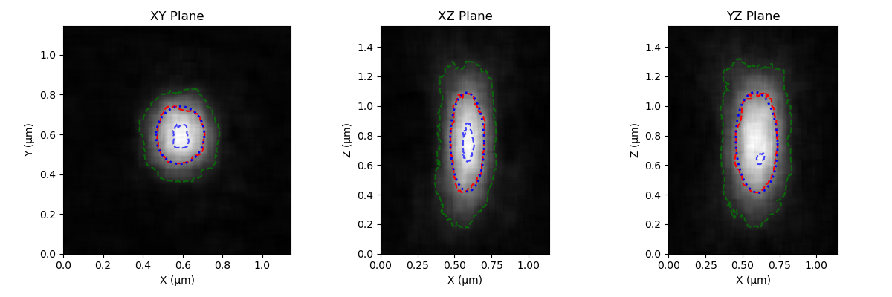
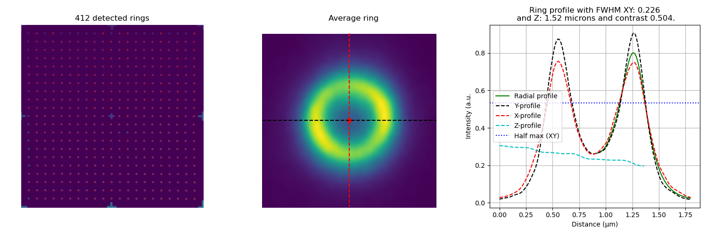
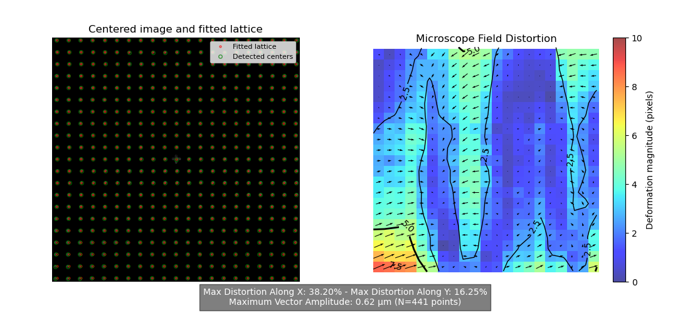
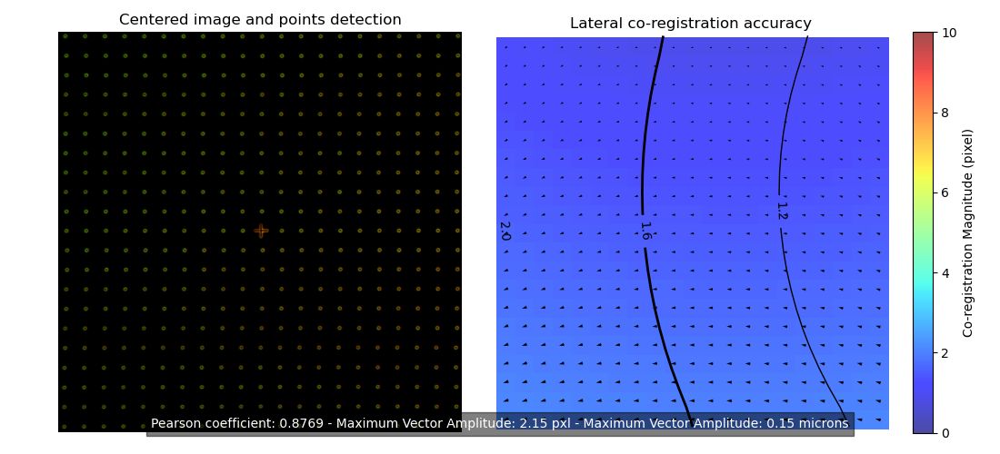
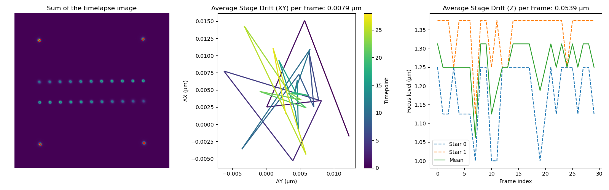
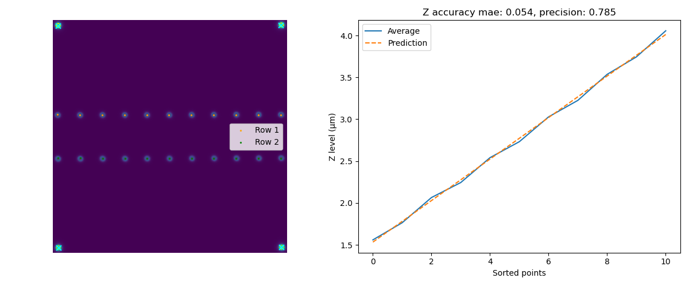

# METEOR-core

[](LICENSE)
[](https://www.python.org/)
[](https://github.com/CCI-GU-Sweden/METEOR-core/actions/workflows/ci.yml)

Metrology Engine for Optical Robustness — Core Algorithms

METEOR-core is the analysis engine of the METEOR ecosystem and presents a unified framework for **microscope performance evaluation**.  
This package contains **only the computational algorithms** (the “core”).

Visualization, scoring dashboards, and acquisition automation are handled by:

- [**METEOR-view**](https://github.com/CCI-GU-Sweden/METEOR-view) (web visualization & scoring — Flask)
- [**METEOR-napari**](https://github.com/CCI-GU-Sweden/METEOR-napari) (Standalone analysis + visualization — Napari)
- **METEOR-smart** (smart microscopy & automated acquisition workflows) *(upcoming)*

## Content

- [Purpose](#purpose)
- [Installation](#installation)
- [Examples](#usage-example)
- [Troubleshootings](#troubleshooting)

## Quick Start

1. Open an image in Python with the adequate reader
2. Extract the metadata required from it (pixel size, image dimension and axis order)
3. Run the desired analysis by importing the adequate plugin
4. Extract the result from the output dictionnary ('figure' and 'measurements')

---

## Purpose

Modern fluorescence microscopes require periodic quantitative performance checks.  
METEOR-core provides a **complete algorithmic suite** for evaluating the health and robustness of:

- Objective lenses
- Illumination systems
- Detection paths
- Stages and focus drives
- Imaging stability over time

The package is designed to integrate seamlessly into:

- Core facilities
- Quality control pipelines
- Automated calibration workflows
- Scientific microscope-as-a-service environments

---

## Requirements

The suite is built on the hypothesis that the user have access to the [Argolight](https://argolight.com/).

Most metrics are calculated using the 'field of rings' aka 2d rings pattern:

- Ring Spread Function (FWHM X/Y)
- Distortion mapping
- Co-registration
- Field uniformity

Other patterns used for the intensity linearity (4×4 pattern) and FFT-based radial resolution (star-pattern).

Otherwise, bead stacks can be used to measure the PSF (X/Y/Z) and plastic slide can also be used for the field uniformity.

---

## Installation

Local installation (while private / under development):

```bash
git clone https://github.com/CCI-GU-Sweden/METEOR-core.git
cd METEOR-core
pip install -e .[dev]
pre-commit install
```

## Parameters

### Inputs

All of the core functions of METEOR_core takes as input:

- An image as numpy array
- A metadata dictionary. Entries of this dictionnary should contains:

  - 'Physical pixel size X': the size of the pixel in microns. If not defined, assume 1.
  - 'Physical pixel size Z': the size of the Z step in case of Zstack. If not defined, assume 1.
  - 'Image Size C': number of channel - for multi-color analysis only.
  - 'Image Size Z': number of z slice - for Zstack analysis only.
  - 'Image Size T': number of timepoint - for timelapse analysis only.
  - 'axis_order': order of the axis as string, like: TCZYX. Should match the image dimension.
  - 'Lens NA': numerical apperture of the lens (only for PSF analysis).

Other parameters are prefilled. Please consult the documentation of each function.

### Outputs

Each main function will return a dictionnary with the following entries:

- 'figure': contain a matplotlib.figure that can be saved with fig.savefig. None if failed.
- 'figure name': name and directory of the image to save. Same name than the image
- 'status': if the measurement was a success, failure or error
- 'measurements': A list of dictionnary containing the most important measure:
  - 'category' - the type of measure (e.g. 'PSF', 'RSF'...)
  - 'name' - the name of the measure itself (e.g 'FWHM XY', 'PSF X'...)
  - 'value' - the value of the measure itself. A number (float)
  - 'unit' - the unit of the measure (e.g. 'µm', 'degree', '' for no unit)
- 'extra_measurements': a dictionnary containing extra number. No units, pure number, and no much context.
- for PSF only: 'gif' - array to be able to generate the PSF beads evolution
- for PSF only: 'tiff' - array (ZXY) containing the calculated PSF

If using the `metrology_splitter` function in the `metrology` module, the function will return a list of results dictionnary instead.

For ring distortion, ring uniformity, co-registration and 4×4 intensity,
the reference Z plane is selected independently of the reported metric. The
selector uses the first channel and ranks planes by smoothed image-gradient
energy using a common robust intensity scale. On successful results,
`extra_measurements` includes `best_z_plane`, `focus_scores` and
`focus_at_stack_boundary`. A boundary selection means that the focus peak may
lie outside the acquired stack; it is not a guarantee that the chosen plane is
in focus. The score can be affected by noise, saturation, background structure
and differences in signal between planes. It has not yet been calibrated as a
focus-quality or uncertainty measure. If analysis fails on the selected plane,
it returns an error instead of optimizing the reported metric across planes.
RSF currently retains its middle-plane reference.

For integer stacks of up to 16 bits, focus percentiles are computed exactly
from a histogram without copying the full stack to floating point. For large
floating-point stacks, they are estimated from a deterministic sample of
approximately one million pixels; this can change the selected focus plane.
RSF processes ring crops sequentially and accumulates their average instead of
running one upsampled volume per CPU and retaining all volumes in memory. This
limits parallel memory growth, with a possible runtime trade-off. The CZI reader
still loads the full image, and figures and other analyses allocate additional
memory, so job limits must account for the input dimensions and channels.

Ring distortion, co-registration and Argolight uniformity register detected
centers in the original image frame using a square similarity lattice. Detection
tries triangle, Otsu and Yen segmentation and selects the first threshold with
the most one-to-one lattice matches; the selected threshold is reported. The fit
removes translation, rotation **and uniform scale**, so distortion residuals do
not include global magnification error. The fitted pitch, residuals and match
counts are reported in `extra_measurements['ring_registration']`; lattice
indices are relative and do not identify an absolute target location. The
nominal pitch is an input assumption and the fit allows a 15% deviation; its
matching gate and quality limits are initial, uncalibrated choices.

Co-registration compares observed centers, including the global channel
offset, using a gate of 35% of the ring pitch. Offsets close to or larger than
half a pitch can be ambiguous or rejected. Uniformity requires detected rings
to span the expected grid and at least 70% of its ROIs to be fully visible;
missing and clipped ROIs are excluded rather than treated as dark. Its min/max
result uses the observed ROIs without the previous grid median filter, so it
is not directly comparable to earlier versions and may depend on which camera
field was sampled. Background correction and evidence-based quality limits
remain to be validated. Existing distortion percentage extras also require a
separate unit and denominator review before quantitative use.

The 4×4 intensity analysis defaults to the Argo-SIM geometry: 6 µm-wide
elements on a nominal 10 µm pitch. The [Argo-SIM v2 guide](https://argolight.com/files/Argo-SIM/Argo-SIM-v2.0_User-guide.pdf)
describes the 6 µm elements and a 36 µm-wide four-element pattern; the 10 µm
pitch follows from those dimensions. Check the actual slide and override
`pattern_size` and `spacing` if needed. Signal ROIs and local background are
measured in the original image units. The fitted grid is in the camera frame;
its relative row/column labels do not establish the slide's physical
orientation. Per-element signals and diagnostics are in `extra_measurements`.

Without a verified, correctly oriented expected-response matrix, the legacy
`Linearity of Intensity` measurement is `None`. The additional `Pattern signal
range` is descriptive, not a detector-linearity measurement. A caller may pass
`expected_levels` as a 4×4 array **in the reported camera-frame row/column
orientation** to calculate the linear fit, residuals and R². The caller must
verify the response values and their orientation; an assumed or incorrectly
oriented layout is not a calibration. Set `saturation_value` to the actual
detector ceiling. Without it, the dtype maximum is checked when available but
the result warns that saturation is unverified. This changes the meaning and
number of intensity measurement entries, so downstream consumers must handle a
missing linearity value and the additional descriptive measurement. Fixed ROIs
and background correction still need validation across acquisitions;
low-signal elements are flagged.

Up to you to plug this output in your pipeline (database saving, Omero key-value pair...).

## Usage Example

```python
import METEOR_core

img, metadata = METEOR_core.functions.reader("upload/star/40x_star.czi")

res = METEOR_core.star_resolution.star_resolution_analysis(img, metadata)
print(res["measurements"])
```

A full pipeline classification system is available via (caveat: the reader supports only czi files):

```python
from METEOR_core.metrology import metrology_splitter
from METEOR_core.functions import reader

img, metadata = reader("image_name.czi")
results = metrology_splitter(img, "image_name.czi", metadata)
```

The splitter uses image content and structured annotations, not the filename
alone. Inspect the classification before routing when a user needs to choose:

```python
from METEOR_core.classification import classify_image
from METEOR_core.metrology import metrology_splitter

classification = classify_image(img, metadata, name="image_name.czi")
print(classification["category"], classification["candidates"])
print(classification["warnings"])

# If the pattern is known, explicitly select it, for example a PSF bead stack:
results = metrology_splitter(img, "image_name.czi", metadata, category_override="psf")
```

Supported explicit overrides and `pattern_type`/`analysis_type` metadata values
include `2d rings`, `4x4 intensity`, `star`, `psf`, `plastic`, `crossing stairs`
and the existing category names. Ring, intensity and star image detectors use
geometric heuristics. Sparse bead detections are suggestions only; plastic and
crossing-stairs images generally need an explicit annotation or override.
Filename hints never authorize routing by themselves. Missing or conflicting
evidence returns `Unknown` with `requires_review=True`; `metrology_splitter`
then returns `False`. Its successful results include a `classification` field.
`confidence` values such as `strong` are qualitative evidence labels, not
calibrated probabilities. Automatic detection is intended for Argo-SIM geometry
and must be validated for other slides. A known image category can still fail
an analysis if its channel, Z or time axes are unsuitable.

The classifier inspects the first channel and time point and selects a focus
plane. Multiple scenes require the caller to select a scene and update axis
metadata before automatic classification. `classify(name, metadata)` and
`by_name(name)` remain filename-only legacy helpers; they are not used by the
splitter's automatic routing.

The different imports for analysis:

```python
from METEOR_core.coregistration_analysis import coregistration_analysis as ca
from METEOR_core.distortion_analysis import distortion_analysis as da
from METEOR_core.intensity_analysis import intensity_analysis as ia
from METEOR_core.plastic_uniformity import calculate_field_uniformity as fu
from METEOR_core.psf_analysis import psf_analysis as psf
from METEOR_core.RSF import RSF_analysis as rsf
from METEOR_core.stack_accurancy import stack_precision as sp
from METEOR_core.stage_stability import measure_stage_stability as ms
from METEOR_core.star_resolution import star_resolution_analysis as sr
from METEOR_core.uniformity_analysis import uniformity_analysis as ua
```

### Figures example

PSF:


RSF:


Star pattern:


Field distortion


Image Co-registration


Field illumination uniformity
Argolight


Plastic


Linearity of intensity


Stage stability


Stage Z-calibration accuraccy


## Citation

When publishing results obtained using METEOR-core, please cite:

METEOR-core: A Unified Metrology Engine for Automated Assessment of Microscope Performance
(2025) — GitHub: https://github.com/CCI-GU-Sweden/METEOR-core

A DOI will be added once the project is archived on Zenodo or published.

## Contributing

Contributions, issues and feature requests are welcome!
Internal contributors: please use the GitHub private repo.

## Troubleshooting
