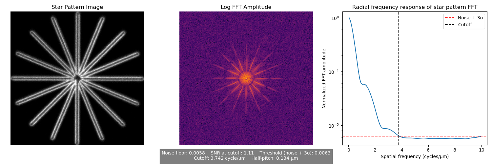
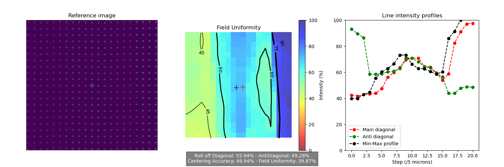
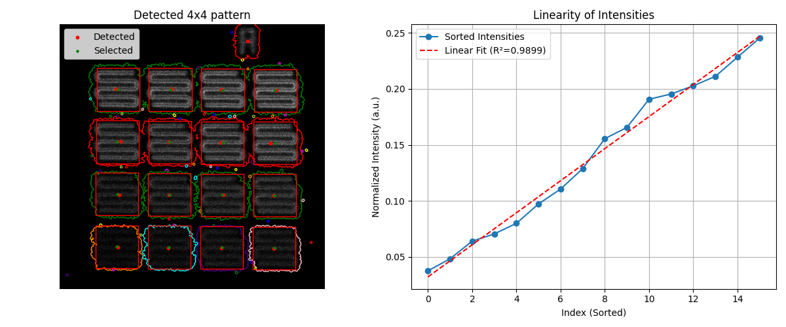

# METEOR-core

[](LICENSE)
[](https://www.python.org/)
[](https://github.com/CCI-GU-Sweden/METEOR-core/actions/workflows/ci.yml)

Metrology Engine for Optical Robustness — Core Algorithms

METEOR-core is the analysis engine of the METEOR ecosystem and presents a unified framework for **microscope performance evaluation**.  
This package contains **only the computational algorithms** (the “core”).

Visualization, scoring dashboards, and acquisition automation are handled by:

- [**METEOR-view**](https://github.com/CCI-GU-Sweden/METEOR-view) (web visualization & scoring — Flask)
- [**METEOR-napari**](https://github.com/CCI-GU-Sweden/METEOR-napari) (Standalone analysis + visualization — Napari)
- **METEOR-smart** (smart microscopy & automated acquisition workflows) *(upcoming)*

## Content

- [Purpose](#purpose)
- [Installation](#installation)
- [Examples](#usage-example)
- [Troubleshootings](#troubleshooting)

## Quick Start

1. Open an image in Python with the adequate reader
2. Extract the metadata required from it (pixel size, image dimension and axis order)
3. Run the desired analysis by importing the adequate plugin
4. Extract the result from the output dictionnary ('figure' and 'measurements')

---

## Purpose

Modern fluorescence microscopes require periodic quantitative performance checks.  
METEOR-core provides a **complete algorithmic suite** for evaluating the health and robustness of:

- Objective lenses
- Illumination systems
- Detection paths
- Stages and focus drives
- Imaging stability over time

The package is designed to integrate seamlessly into:

- Core facilities
- Quality control pipelines
- Automated calibration workflows
- Scientific microscope-as-a-service environments

---

## Requirements

The suite is built on the hypothesis that the user have access to the [Argolight](https://argolight.com/).

Most metrics are calculated using the 'field of rings' aka 2d rings pattern:

- Ring Spread Function (FWHM X/Y)
- Distortion mapping
- Co-registration
- Field uniformity

Other patterns used for the intensity linearity (4×4 pattern) and FFT-based radial resolution (star-pattern).

Otherwise, bead stacks can be used to measure the PSF (X/Y/Z) and plastic slide can also be used for the field uniformity.

---

## Installation

Local installation (while private / under development):

```bash
git clone https://github.com/CCI-GU-Sweden/METEOR-core.git
cd METEOR-core
pip install -e .[dev]
pre-commit install
```

## Parameters

### Inputs

All of the core functions of METEOR_core takes as input:

- An image as numpy array
- A metadata dictionary. Entries of this dictionnary should contains:

  - 'Physical pixel size X': the size of the pixel in microns. If not defined, assume 1.
  - 'Physical pixel size Z': the size of the Z step in case of Zstack. If not defined, assume 1.
  - 'Image Size C': number of channel - for multi-color analysis only.
  - 'Image Size Z': number of z slice - for Zstack analysis only.
  - 'Image Size T': number of timepoint - for timelapse analysis only.
  - 'axis_order': order of the axis as string, like: TCZYX. Should match the image dimension.
  - 'Lens NA': numerical apperture of the lens (only for PSF analysis).

Other parameters are prefilled. Please consult the documentation of each function.

### Outputs

Each main function will return a dictionnary with the following entries:

- 'figure': contain a matplotlib.figure that can be saved with fig.savefig. None if failed.
- 'figure name': name and directory of the image to save. Same name than the image
- 'status': if the measurement was a success, failure or error
- 'measurements': A list of dictionnary containing the most important measure:
  - 'category' - the type of measure (e.g. 'PSF', 'RSF'...)
  - 'name' - the name of the measure itself (e.g 'FWHM XY', 'PSF X'...)
  - 'value' - the value of the measure itself. A number (float)
  - 'unit' - the unit of the measure (e.g. 'µm', 'degree', '' for no unit)
- 'extra_measurements': a dictionnary containing extra number. No units, pure number, and no much context.
- for PSF only: 'gif' - array to be able to generate the PSF beads evolution
- for PSF only: 'tiff' - array (ZXY) containing the calculated PSF

If using the `metrology_splitter` function in the `metrology` module, the function will return a list of results dictionnary instead.

Up to you to plug this output in your pipeline (database saving, Omero key-value pair...).

## Usage Example

```python
import METEOR_core

img, metadata = METEOR_core.functions.reader("upload/star/40x_star.czi")

res = METEOR_core.star_resolution.star_resolution_analysis(img, metadata)
print(res["measurements"])
```

A full pipeline classification system is available via (caveat: the reader supports only czi files):

```python
from METEOR_core.metrology import metrology_splitter
from METEOR_core.functions import reader
img, metadata = reader("image_name.czi")
results = metrology_splitter(img, "image_name.czi", metadata)
```

The different imports for analysis:

```python
from METEOR_core.coregistration_analysis import coregistration_analysis as ca
from METEOR_core.distortion_analysis import distortion_analysis as da
from METEOR_core.intensity_analysis import intensity_analysis as ia
from METEOR_core.plastic_uniformity import calculate_field_uniformity as fu
from METEOR_core.psf_analysis import psf_analysis as psf
from METEOR_core.RSF import RSF_analysis as rsf
from METEOR_core.stack_accurancy import stack_precision as sp
from METEOR_core.stage_stability import measure_stage_stability as ms
from METEOR_core.star_resolution import star_resolution_analysis as sr
from METEOR_core.uniformity_analysis import uniformity_analysis as ua
```

### Figures example

PSF:


RSF:


Star pattern:


Field distortion


Image Co-registration


Field illumination uniformity
Argolight


Plastic


Linearity of intensity


Stage stability


Stage Z-calibration accuraccy


## Citation

When publishing results obtained using METEOR-core, please cite:

METEOR-core: A Unified Metrology Engine for Automated Assessment of Microscope Performance
(2025) — GitHub: https://github.com/CCI-GU-Sweden/METEOR-core

A DOI will be added once the project is archived on Zenodo or published.

## Contributing

Contributions, issues and feature requests are welcome!
Internal contributors: please use the GitHub private repo.

## Troubleshooting
