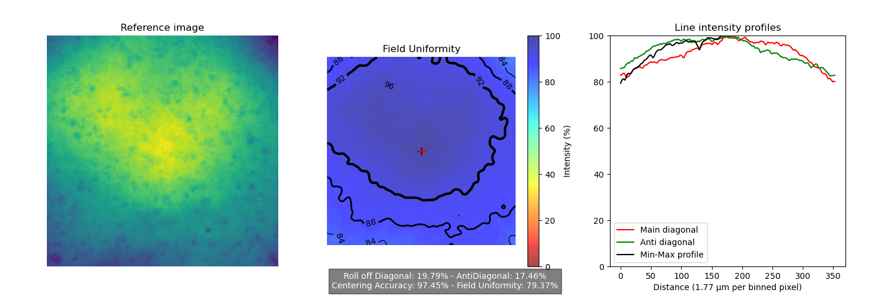

# METEOR-core

Metrology Engine for Optical Robustness — Core Algorithms

METEOR-core is the analysis engine of the METEOR ecosystem:  
a unified framework for **microscope performance evaluation**.

This package contains **only the computational algorithms** (the “core”).  
Visualization, scoring dashboards, and acquisition automation are handled by:

- **METEOR-view** (web visualization & scoring — Flask) *([Github](https://github.com/CCI-GU-Sweden/METEOR-view))*

Acquisition by: 

- **METEOR-smart** (smart microscopy & automated acquisition workflows) *(upcoming)*

---

## 🧭 Purpose

Modern fluorescence microscopes require periodic quantitative performance checks.  
METEOR-core provides a **complete algorithmic suite** for evaluating the health and robustness of:

- Objective lenses  
- Illumination systems  
- Detection paths  
- Stages and focus drives  
- Imaging stability over time  

The package is designed to integrate seamlessly into:

- Core facilities  
- Quality control pipelines  
- Automated calibration workflows  
- Scientific microscope-as-a-service environments  

---

## ✨ Features

### 🔬 Optical Quality Metrics

- PSF (X/Y/Z FWHM) from bead stacks  
- Ring Spread Function (Argolight 2d rings pattern)  
- FFT-based radial resolution  (Argolight star-pattern)  

### 🧩 Geometric Accuracy

- Distortion mapping from Argolight 2D rings (Argolight 2d rings pattern)   
- Co-registration accuracy across channels (Argolight 2d rings pattern)   

### 🌈 Illumination & Detector Metrics

- Field uniformity (Argolight 2d rings pattern and plastic slide)  
- Centering accuracy (Argolight 2d rings pattern and plastic slide)  
- Intensity linearity (Argolight 4×4 pattern)

### 🏃 Stability & Drift

- XY drift across time  
- Z drift across sequences  
- Staircase Z-calibration accuracy  

### 🗂 File Format Support

- Native **CZI** reading  
- Dimension-aware slicing (`TCZYX` handling)  

---

## 📦 Installation

Local installation (while private / under development):

```bash
git clone https://github.com/CCI-GU-Sweden/METEOR-core.git
cd METEOR-core
pip install -e .
```

## Parameters

### Inputs

All of the core functions of METEOR_core takes as input:

- An image as numpy array
- A metadata dictionary. Entries of this dictionnary should contains:

    - 'Physical pixel size X': the size of the pixel in microns. If not defined, assume 1.
    - 'Physical pixel size Z': the size of the Z step in case of Zstack. If not defined, assume 1.
    - 'Image Size C': number of channel - for multi-color analysis only.
    - 'Image Size Z': number of z slice - for Zstack analysis only.
    - 'Image Size T': number of timepoint - for timelapse analysis only.
    - 'axis_order': order of the axis as string, like: TCZYX. Should match the image dimension.
    - 'Lens NA': numerical apperture of the lens (only for PSF analysis).

Other parameters are prefilled. Please consult the documentation of each function.

### Outputs

Each main function will return a dictionnary with the following entries:

- 'figure': contain a matplotlib.figure that can be saved with fig.savefig. None if failed.
- 'figure name': name and directory of the image to save. Same name than the image
- 'status': if the measurement was a success, failure or error
- 'measurements: A list of dictionnary containing the most important measure:
    - 'category' - the type of measure (e.g. 'PSF', 'RSF'...)
    - 'name' - the name of the measure itself (e.g 'FWHM XY', 'PSF X'...)
    - 'value' - the value of the measure itself. A number (float)
    - 'unit' - the unit of the measure (e.g. 'µm', 'degree', '' for no unit)
- 'extra_measurements': a dictionnary containing extra number. No units, pure number, and no much context.
- for PSF only: 'gif' - array to be able to generate the PSF beads evolution
- for PSF only: 'tiff' - array (ZXY) containing the calculated PSF

If using the `metrology_splitter` in the `metrology` module, the function will return a list of results dictionnary instead.

Up to you to plug this output in your pipeline (database saving, Omero key-value pair...).

## 🧪 Usage Example

```python
import METEOR_core

img, metadata = METEOR_core.functions.reader("upload/40x_star.czi")

res = METEOR_core.star_resolution.star_resolution_analysis(img, metadata)
print(res["measurements"])
```

A full pipeline classification system is available via:

```python
from METEOR_core.metrology import metrology_splitter
from METEOR_core.functions import reader
img, metadata = reader("image_name.czi")
results = metrology_splitter(img, "image_name.czi", metadata)
```

### Figures example

PSF:


RSF:


Star pattern:


Field distortion


Image Co-registration


Field illumination uniformity
Argolight


Plastic


Linearity of intensity


Stage stability


Stage Z-calibration accuraccy


## 📣 Citation

When publishing results obtained using METEOR-core, please cite:

METEOR-core: A Unified Metrology Engine for Automated Assessment of Microscope Performance
(2025) — GitHub: https://github.com/CCI-GU-Sweden/METEOR-core

A DOI will be added once the project is archived on Zenodo or published.

## 🤝 Contributing

Contributions, issues and feature requests are welcome!
Internal contributors: please use the GitHub private repo.

## 🌌 Part of the METEOR Ecosystem

METEOR-core — computational metrology engine

METEOR-view — browser-based scoring & visualization (in development)

METEOR-smart — automated smart microscopy (upcoming)
